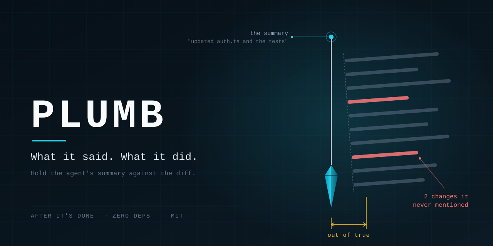

<div align="center">



# plumb

**What it said. What it did.**

Part of [Singh Labs](https://singhlabs.dev/plumb/) — guardrails for AI coding agents.

Created by [Manpreet Singh](https://github.com/manpreet171)

[Product page](https://singhlabs.dev/plumb/) · [The four findings](docs/findings.md)

  

</div>

---

```
before   the agent says "added retry logic and updated the tests" → you merge
after    plumb says it also touched a file it never mentioned, and skipped a test
```

## Why

An agent finishes. It hands you a tidy paragraph. You skim the paragraph, not the
diff, because the diff is nine hundred lines and it's late.

The paragraph is not a lie. It's just **incomplete in the direction that matters** —
nobody writes *"and I deleted an assertion so the suite would go green."* A summary
is written to explain the work, and that sentence isn't an explanation, it's a
confession. Different genres, and only one gets written automatically.

`plumb` holds the paragraph against `git diff` and prints only the difference.

## Quickstart

```bash
npm install -g github:manpreet171/plumb
```

Save what the agent told you, then hold it up:

```bash
plumb check summary.md
```

Real output, from the repo in [`examples/skipped-a-test/`](examples/skipped-a-test/):

```
plumb — 3 files changed, 2 named in the summary

changed but never mentioned  (read these first)
  · src/config.js modified

quiet cuts  (removed or silenced, whatever the summary says)
  · src/auth.js:1 error path removed
    if (!user || !pass) throw new Error('missing credentials');
  · test/auth.test.js:1 test skipped
    it.skip('rejects empty credentials', () => {

3 things the summary did not tell you.
```

Exit code `1`. The summary had said *"I added retry logic to src/auth.js and
updated the tests in test/auth.test.js. All tests pass."* — which was true, and
missed all three.

When the summary is complete:

```
plumb — 2 files changed, 2 named in the summary

the summary holds. Every change was named, nothing was quietly cut.
```

Exit code `0`.

## The four findings

| | What it means | Why you care |
| - | ------------- | ------------ |
| **Changed but never mentioned** | A file changed *or newly created* whose name appears nowhere in the summary | The one that bites you in three days |
| **Quiet cuts** | A guard, assertion, test case or error path that is gone | Green tests bought by deleting the test |
| **Mutes** | `.skip`, `xit`, `@ts-ignore`, `# noqa`, `continue-on-error: true` added | The failure is still there, just not printed |
| **Mentioned but not changed** | A path claimed in the summary that the diff never touched | The agent describing work it did not do |

Quiet cuts and mutes are reported **whether or not the file was claimed**, because
they are never in the summary anyway.

## Commands

| Command | Does |
| ------- | ---- |
| `plumb check <file>` | Hold that summary against the working tree |
| `cat s.md \| plumb check` | Same, from stdin |
| `plumb check --base main` | Compare against a branch or commit instead of `HEAD` |
| `plumb check --pr 42` | Check a pull request: does the description match the diff, and do the symbols it names exist? |
| `plumb check --json` | Machine-readable, for your own tooling |
| `plumb check --warn-only` | Always exit 0 — for a soft rollout |
| `plumb version` | Print the version |

Exit codes: **0** clean · **1** findings · **2** usage error.

## What's in the box

```
plumb/
├── bin/plumb.mjs         the whole tool, one file, no dependencies
├── test/plumb.test.mjs   builds a real git repo and plays an agent run through it
├── examples/             two real runs, with their summaries and their reports
├── docs/findings.md      every rule, and why a refactor stays quiet
└── PLUMB.md              the zero-install version: paste it at your agent
```

## Works with what you already use

Anything that writes a summary and edits a git repo — Claude Code, Cursor, Codex,
Copilot, Aider, or a colleague on Slack. `plumb` never talks to your agent. It
reads a text file and it reads `git`. That's the whole integration surface.

In CI, gate on the exit code:

```yaml
- run: npx github:manpreet171/plumb check summary.md
```

No CLI at all? [`PLUMB.md`](PLUMB.md) is the same four checks written as
instructions you can paste into your agent's context.

## FAQ

**Isn't this just `git diff`?**
Yes, plus the part you skip. `git diff` shows you 900 lines and trusts you to
notice which ones nobody mentioned. This shows you the three.

**Won't a refactor set this off constantly?**
That was the first bug. A cut is only reported if the thing is actually gone —
if the matched token still appears anywhere in that file's added lines, it's a
rename or a reformat and `plumb` stays quiet. False positives are the only fatal
bug in a tool like this.

**Does it use an LLM?**
No. It's regexes and `git`. It runs offline, in a fraction of a second, and costs
nothing per run.

**Why is it called plumb?**
A plumb line tells you whether the wall is actually straight, whatever the
builder says.

## Uninstall

```bash
npm uninstall -g plumb-diff
```

It writes nothing outside the repo — no config, no cache, no state directory.
Delete `PLUMB.md` if you copied it in. That's all of it.

## Author

**Manpreet Singh** — [GitHub](https://github.com/manpreet171) ·
[LinkedIn](https://www.linkedin.com/in/manpreet17/) ·
[Medium](https://medium.com/@singh.manpreet171900)

More guardrails for people shipping with AI agents: **[singhlabs.dev](https://singhlabs.dev/)**

## License

MIT
